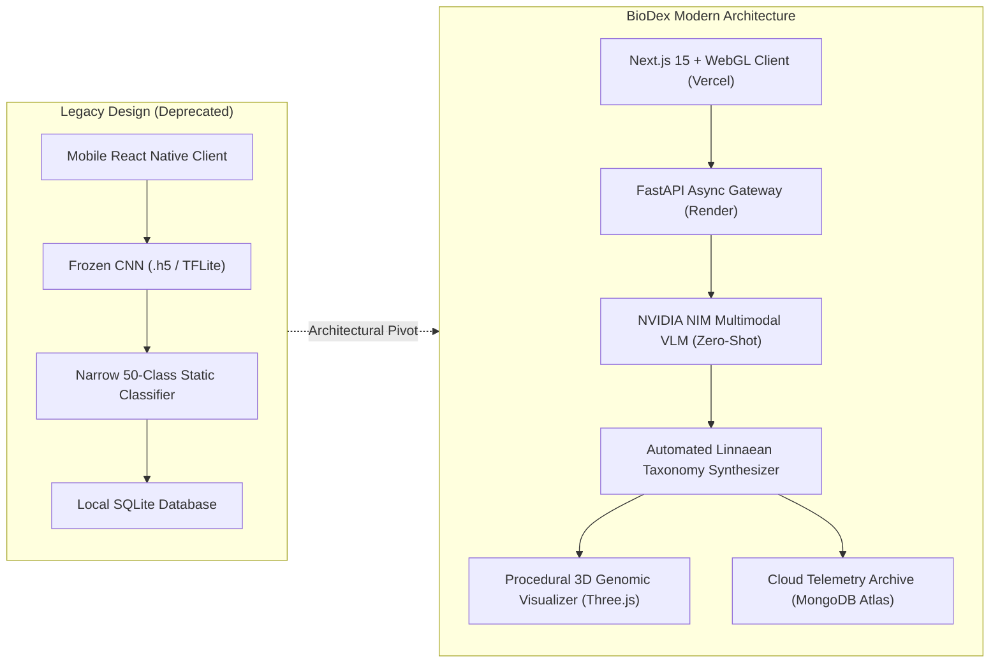
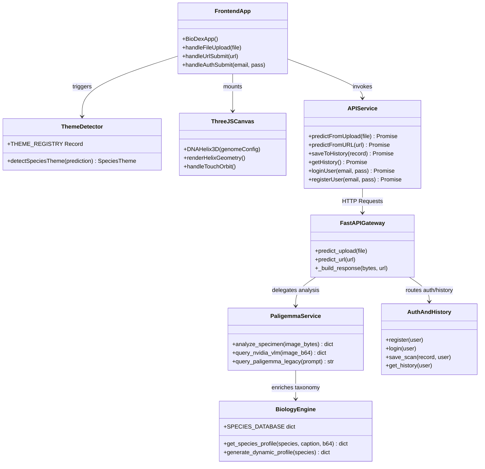
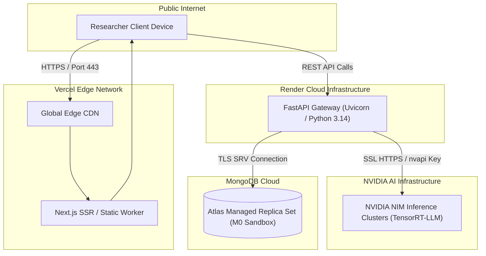

# 🧬 BioDex Engineering Manifest & Technical Specification

> **Biological Intelligence Pipeline · Spectral Species Engine**  
> **Engineering Team:** Neel, Vardhman, Soham | _CGPIT, Uka Tarsadia University_

---

## 📌 Executive Summary & Architectural Evolution

Originally conceived as a traditional mobile application running a frozen Convolutional Neural Network (CNN like ResNet/MobileNet) bounded to ~50 preset biological classes, the **BioDex** architecture underwent an **engineering pivot**.

Rather than limiting classification to narrow, static weights, the core intelligence pipeline was redesigned around **zero-shot Multimodal Vision-Language Models (VLMs)** hosted on accelerated GPU cloud microservices (NVIDIA NIM). Simultaneously, the client was rebuilt as a **Next.js 15 WebGL Glassmorphic Application** featuring interactive Three.js 3D genomic synthesis.



### Strategic Advantages of the Modern Architecture:

1. **Unbounded Zero-Shot Generalization:** Eliminates the static 50-class boundary. Identifies virtually any living organism (mammals, plants, birds, insects, reptiles, marine life, fungi) using high-capacity multimodal foundation models.
2. **Browser-Native 3D Genomic Visualization:** Harnesses WebGL through Three.js to render real-time interactive DNA helix geometries mapped to the organism's classified taxon.
3. **Resilient Cloud Persistence:** Deploys a cloud-native database tier on MongoDB Atlas with RFC 7518-compliant HS256 JWT security and native `bcrypt` password encryption.

---

## 🏛️ Comprehensive Component Architecture



---

## 🔄 End-to-End Pipeline Data Flow

```mermaid
sequenceDiagram
    autonumber
    actor Client as User Browser / Device
    participant UI as Next.js 15 Client
    participant GW as FastAPI Gateway (Render)
    participant VLM as NVIDIA NIM Cloud
    participant Wiki as Wikipedia REST API
    participant DB as MongoDB Atlas

    Client->>UI: Selects Specimen Image (File/Camera/URL)
    UI->>UI: Render Scanning Animation & Laser Grid
    UI->>GW: POST /predict/upload (multipart/form-data)

    rect rgb(20, 30, 40)
        Note over GW,VLM: Preprocessing & Neural Vision Inference
        GW->>GW: PIL: Convert RGB, Thumbnail (512x512), Compress JPEG (Q85)
        GW->>GW: Encode to Base64 String
        GW->>VLM: POST /chat/completions (meta/llama-3.2-11b-vision-instruct)
        VLM-->>GW: Return Structured JSON { species, scientific_name, caption, confidence }
    end

    rect rgb(30, 40, 30)
        Note over GW,Wiki: Biological Taxonomy & Ecological Profiling
        GW->>GW: Query local taxonomy database (SPECIES_DATABASE)
        opt Not in Local Knowledge Base
            GW->>Wiki: GET /page/summary/{species_name}
            Wiki-->>GW: Extract verified ecological & botanical facts
        end
        GW->>GW: Assemble 7-tier Linnaean tree + conservation + diet
        GW->>GW: Synthesize deterministic genome seed (size, genes, GC content)
    end

    GW-->>UI: HTTP 200 { status: "success", prediction: { ... } }

    rect rgb(40, 20, 30)
        Note over UI,Client: Reactive Visual Rendering
        UI->>UI: Detect Taxonomic Kingdom/Class
        UI->>UI: Switch Matrix Theme CSS Variables (MAM-Crimson, BOT-Emerald, etc.)
        UI->>UI: Initialize Three.js 3D DNA Canvas with Genome Twist & Particle Density
        UI->>UI: Animate Decrypted Text for Specimen Common Name
    end

    opt Researcher Authenticated
        UI->>GW: POST /history (prediction payload) with Bearer JWT
        GW->>GW: Strip local base64 blobs from document
        GW->>DB: Persist sanitized scan record
        DB-->>GW: Record Inserted
        GW-->>UI: HTTP 200 { status: "success" }
    end
```



---

## 🔒 Security & Data Integrity Compliance

### 1. Cryptographic Key Length (RFC 7518 §3.2)

- To prevent brute-force signature forgery on symmetric JSON Web Tokens, the application utilizes a **57-character cryptographic key**:
    ```text
    SECRET_KEY=biodex-production-jwt-security-key-2026-v1-supersecret
    ```
- Exceeds the 256-bit (32-byte) requirement, eliminating `InsecureKeyLengthWarning` errors across all modern JWT validators (`PyJWT`).

### 2. Native Bcrypt Password Hashing

- Migrated from legacy `passlib` to direct `bcrypt` bindings.
- **72-Byte Truncation Guard:** Automatically clamps raw password inputs to 72 bytes prior to hashing, preventing OpenSSL backend buffer faults on newer Python runtimes (e.g., Python 3.14).

### 3. Telemetry Payload Sanitization

- Local `data:image/...` base64 strings and temporary file URIs are automatically stripped before writing scan records to MongoDB Atlas. This guarantees:
    - Document sizes remain in the low kilobyte range ($< 5\text{ KB}$).
    - Database collection performance remains optimal.
    - No bloated or unoptimized blobs are persisted across researcher histories.

---

## 📊 Deployment & Infrastructure Topology



---

## 🛠️ Verification & Test Suite

All core subsystems are covered by end-to-end integration tests:

1. **Multimodal VLM Inference Test:**
    - Evaluates image ingestion across animal, insect, avian, and botanical test specimens.
    - Validates that returned JSON conforms to the strict schema (`species`, `scientific_name`, `category`, `caption`, `confidence`).
2. **Taxonomy & Linnaean Tree Verification:**
    - Confirms that binomial Latin names accurately map to corresponding genus and species entries.
3. **Auth & History Lifecycle Test:**
    - Validates user registration, password verification with bcrypt, JWT token generation, authenticated history commits, and reverse-chronological retrieval.

---

## 🔮 Future Scalability Roadmap

- [ ] **Real-Time Video Stream Inference:** Enable continuous camera frame sampling with WebRTC to track organisms in motion.
- [ ] **Genomic Sequencing API Integration:** Pull real verified chromosomal nucleotide base sequences from NCBI Entrez APIs.
- [ ] **Offline Edge Mode:** Package lightweight quantization models (ONNX Runtime / WebGPU) for local offline field research.
- [ ] **Desktop Client:** Package via Tauri for native offline research workstation deployment.

---

_BioDex Documentation — Maintained by the BioDex Engineering Team._
