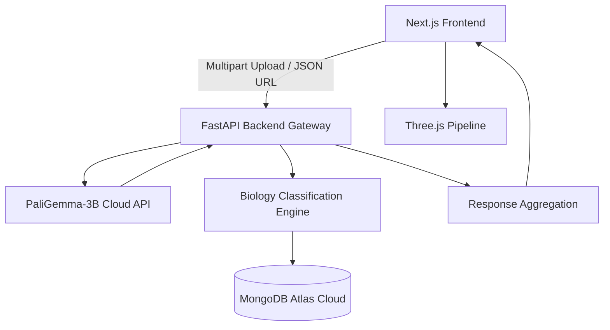

# 🧬 BioDex — Spectral Species Engine


**BioDex** is an advanced, browser-native Biological Intelligence Pipeline. It provides biological species identification, taxonomic synthesis, and WebGL genomic mapping by analyzing optical specimen data. Utilizing large-scale multimodal vision architectures (PaliGemma 3B), BioDex can isolate structural morphology and phenotypic traits from an image or URL and synthesize comprehensive scientific intelligence.

---

## 🔥 Key Features

- **Optical Sensor Analyzer (VLM Inference):** Upload a raw image cache or provide a direct remote URL stream. BioDex interfaces directly with Nvidia NIM APIs utilizing the **PaliGemma-3B** Multimodal Vision-Language Model to perform zero-shot biological taxonomy mapping.
- **WebGL Interactive Genome Visualization:** Watch procedurally generated DNA structures wrap around the viewport corresponding to the organism's classified taxon. Renderings map scale size, base pair matrices, and phylogenetic aesthetics utilizing **Three.js**.
- **Dynamic Spectral Theming:** The user interface reacts holistically to the specimen. Analyzing wildlife casts the UI in Crimson; foliage casts Emerald matrices; arthropods generate Amber bioluminescence, and marine scans switch to Deep Aqua. Particle systems adapt passively in the background dynamically driven by `framer-motion`.
- **Specimen Telemetry Archive:** Cloud-synchronized history logs via MongoDB Atlas persist classified intelligence per researcher identity.

---

## 🏗️ Architecture



### 💻 Frontend (Web / Client)
- **Framework:** Next.js (App Router), React 19
- **Styling/Animations:** TailwindCSS (`backdrop-blur-2xl` glassmorphism), Framer Motion
- **3D Graphics:** Three.js (Procedural DNA generation)
- **UX Layout:** Fully responsive Mobile + Desktop application design.

### ⚙️ Backend (API / Cloud)
- **Framework:** Python, FastAPI, Uvicorn
- **AI/ML Strategy:** Hybrid LLM/VLM processing using PaliGemma 3B hosted on NVIDIA Inference Microservices (NIM) cloud, parsing images + dynamic zero-shot prompts.
- **Classification Engine:** Heuristic biology processor mapping text captions directly to formal Linnaean taxonomic structures.
- **Database / Auth:** PyJWT Bearer Auth, MongoDB Atlas persistence layer.

---

## 🚀 Deployment & Installation Setup

### Prerequisites
- Python 3.10+
- Node.js 18+ / `bun` installed
- NVIDIA NIM API Key
- MongoDB Cloud Instance (URI)

### 1. Initialize API Backend
Change to the backend directory, construct your virtual environment, install the prerequisites, and inject environment parameters before booting the local engine.

```bash
cd backend
python3 -m venv venv
source venv/bin/activate
pip install -r requirements.txt

# Store your secrets in .env
echo "NVS_NIM_API_KEY=your_key_here" > .env
echo "MONGO_URI=mongodb+srv://..." >> .env

# Mount the Uvicorn Gateway
uvicorn main:app --reload --host 0.0.0.0 --port 8000
```
> The API endpoint operates at `http://localhost:8000` with Swagger docs at `/docs`

### 2. Boot The Frontend Client
Mount the React framework to render the console logic. Make sure it points toward port `8000`.

```bash
cd frontend
bun install

# Launch Development Client
bun run dev --port 3000
```
> Access the bio-console locally at `http://localhost:3000`

---

## 📸 Interface Preview 
The ecosystem employs a comprehensive suite of dark-mode optimizations, glowing data vectors, and "Frosted Glass" element properties.

- **Unified Control Grid:** Seamless navigation tabs merging Camera/Upload optics with Telemetry logs.
- **DNA Sandbox:** Directly tap and drag the 3D chromosomal visualization payload dynamically paired to the biological class.
- **Auth Layer:** Complete secure JWT-based researcher verification.

<br/>

> **Built for Scientific Informatics.** 
_Developed by Neel, Vardhman and Soham._
