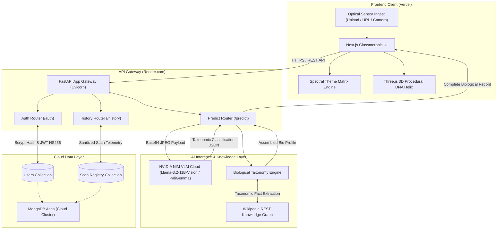
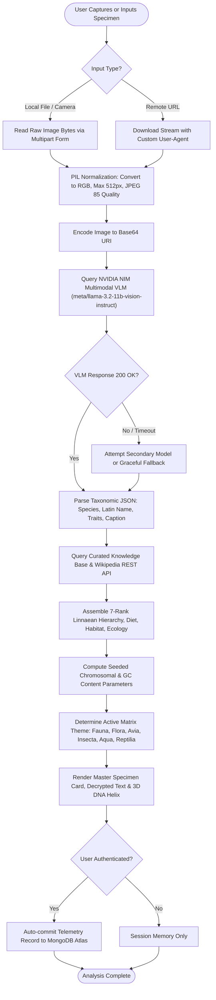
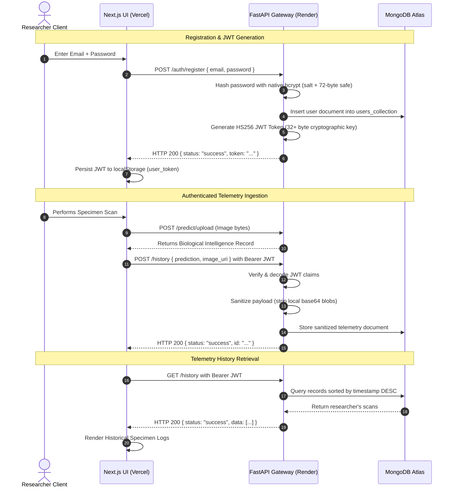

# 🧬 BioDex — Spectral Species Engine

[](https://biodex-core.vercel.app)
[](https://biodex-api.onrender.com)
[](https://fastapi.tiangolo.com/)
[](https://nextjs.org/)
[](https://build.nvidia.com/)
[](https://threejs.org/)
[](https://www.mongodb.com/atlas)

**BioDex** is a high-performance, browser-native **Biological Intelligence Pipeline**. It executes real-time organism identification, full Linnaean taxonomic classification, ecological profiling, and WebGL genomic mapping from optical specimen streams.

By integrating **NVIDIA NIM Multimodal Vision-Language Models (VLM)** with an automated biological synthesis engine and an interactive **Three.js 3D DNA canvas**, BioDex transforms raw sensor captures into comprehensive scientific records.

---

## 🌐 Live Deployments

| Component            | Platform | URL                                                                          | Status  |
| :------------------- | :------- | :--------------------------------------------------------------------------- | :------ |
| **Web Interface**    | Vercel   | [https://biodex-core.vercel.app](https://biodex-core.vercel.app)             | 🟢 Live |
| **API Gateway**      | Render   | [https://biodex-api.onrender.com](https://biodex-api.onrender.com)           | 🟢 Live |
| **Interactive Docs** | Render   | [https://biodex-api.onrender.com/docs](https://biodex-api.onrender.com/docs) | 🟢 Live |

---

## 🏗️ System Architecture



---

## 🔄 Data Flow Diagram (DFD Level 1)

```mermaid
flowchart LR
    User([Researcher / User]) -->|1. Uploads Image or URL| Ingest[Sensor Ingestion & Preprocessing]

    subgraph ProcessingPipeline["BioDex Processing Pipeline"]
        Ingest -->|RGB 512px Optimized JPEG| VLM[NVIDIA NIM Multimodal VLM]
        VLM -->|Species Name & Morphology| Synthesizer[Taxonomy & Ecology Synthesizer]
        Synthesizer -->|Linnaean Tree & Ecological Profile| GenVisual[Procedural Genome Synthesizer]
        GenVisual -->|3D Matrix & GC Content| Aggregator[Response Assembler]
    end

    Aggregator -->|2. Structured Biological Record| User
    Aggregator -->|3. Save Scan with Bearer JWT| DBHandler[Telemetry Persistence Controller]
    DBHandler -->|Sanitized Document| Atlas[(MongoDB Atlas Cluster)]
```



---

## 🧬 End-to-End Analysis Flowchart



---

## 🔐 Authentication & Session Dataflow



---

## ⚡ Core Modules & Innovations

### 1. Optical Sensor Analyzer (Multimodal VLM)

- **High-Throughput VLM:** Interfaces with NVIDIA Inference Microservices (NIM) utilizing `meta/llama-3.2-11b-vision-instruct` (with secondary fallbacks including `microsoft/phi-3-vision-128k-instruct`).
- **Structured Taxonomic Extraction:** Uses strict JSON prompt contracts to extract common vernacular, Latin binomial nomenclature, confidence metrics, and descriptive visual morphology in a single inference cycle (~1.8 seconds).
- **Graceful Fault Tolerance:** Multi-tier degradation chains guarantee that temporary cloud inference outages gracefully fall back without returning 500 errors.

### 2. Biology Knowledge Engine

- **Linnaean Hierarchy Synthesis:** Maps species to full 7-tier Linnaean taxonomy (_Kingdom $\rightarrow$ Phylum $\rightarrow$ Class $\rightarrow$ Order $\rightarrow$ Family $\rightarrow$ Genus $\rightarrow$ Species_).
- **Ecological Intelligence:** Gathers habitat, survival climate, trophic role, diet type (_Apex Carnivore_, _Photoautotroph_, _Heterotroph_), and IUCN Red List conservation status.
- **Dynamic Fact Enrichment:** Integrates with Wikipedia's REST summary endpoint for zero-latency, authoritative scientific descriptions.

### 3. WebGL 3D Interactive Genomic Visualizer

- **Procedural DNA Generation:** Implements coordinate-based parametric formulas within a Three.js canvas:
  $$y = (t - 0.5) \cdot H, \quad \theta = t \cdot 2\pi \cdot \text{Twist}$$
- **Dynamic Chromosomal Parameters:** Maps base pair particles, GC content percentages, and dual-axis glowing ring colors directly to the organism's kingdom and species seed.
- **Interactive Orbit:** Supports smooth touch-dragging and mouse-orbit controls on desktop and mobile viewports.

### 4. Dynamic Spectral Theming

The interface adapts its color palette, accent glows, and molecular particle physics based on the organism's classified taxon:

| Theme Key  | Matrix Code   | Target Domain                 | Primary Accent          |
| :--------- | :------------ | :---------------------------- | :---------------------- |
| `fauna`    | `MAM-CRIMSON` | Mammals & Terrestrial Animals | `#ff3366` (Crimson)     |
| `flora`    | `BOT-EMERALD` | Plants, Trees & Botanicals    | `#00ff88` (Emerald)     |
| `avia`     | `AVI-COBALT`  | Birds & Flying Creatures      | `#38bdf8` (Cobalt Blue) |
| `insecta`  | `ENT-AMBER`   | Insects, Bugs & Arthropods    | `#f59e0b` (Amber)       |
| `aqua`     | `MAR-CYAN`    | Marine Organisms & Fish       | `#06b6d4` (Cyan)        |
| `reptilia` | `REP-VIRID`   | Reptiles & Amphibians         | `#10b981` (Viridian)    |

---

## 🛠️ Tech Stack Matrix

```
┌─────────────────────────────────────────────────────────────┐
│                       BioDex System                         │
├──────────────────────────────┬──────────────────────────────┤
│ Frontend                     │ Backend                      │
├──────────────────────────────┼──────────────────────────────┤
│ • Next.js 15 (App Router)     │ • FastAPI & Uvicorn          │
│ • React 19                   │ • Python 3.10+ / 3.14        │
│ • Three.js (WebGL 3D DNA)    │ • NVIDIA NIM VLM APIs        │
│ • Framer Motion & Lucide     │ • Pillow (PIL) Normalization │
│ • TailwindCSS Glassmorphism  │ • PyJWT (HS256 32-byte key)  │
│ • Axios REST Service         │ • Native Bcrypt Hashing      │
│ • Deployed on Vercel         │ • MongoDB Atlas (pymongo)    │
│                              │ • Deployed on Render         │
└──────────────────────────────┴──────────────────────────────┘
```

---

## 🚀 Local Development Setup

### Prerequisites

- **Node.js 18+** or **Bun**
- **Python 3.10+** (Python 3.11, 3.12, 3.13, 3.14 fully supported)
- **NVIDIA NIM API Key** ([Get one at build.nvidia.com](https://build.nvidia.com/))
- **MongoDB Atlas Connection URI**

---

### 1. Backend Setup

```bash
# Navigate to backend directory
cd backend

# Create and activate virtual environment
python3 -m venv venv
source venv/bin/activate  # On Windows: venv\Scripts\activate

# Install dependencies
pip install -r requirements.txt

# Create environment configuration (.env)
cat <<EOF > .env
MONGO_URI=your_mongodb_atlas_connection_string
SECRET_KEY=biodex-production-jwt-security-key-2026-v1-supersecret
NVIDIA_API_KEY=nvapi-your_nvidia_api_key_here
EOF

# Start API server
uvicorn main:app --reload --host 0.0.0.0 --port 8000
```

> The API will be live at `http://127.0.0.1:8000`. Swagger API documentation is available at `http://127.0.0.1:8000/docs`.

---

### 2. Frontend Setup

```bash
# Navigate to frontend directory
cd frontend

# Install packages
bun install  # or npm install

# Create environment configuration (.env.local)
cat <<EOF > .env.local
NEXT_PUBLIC_API_URL=http://127.0.0.1:8000
EOF

# Launch development server
bun run dev --port 3000  # or npm run dev
```

> Access the BioDex scientific console at `http://localhost:3000`.

---

## 📡 API Specification

| Method | Endpoint          | Description                                       |    Auth Required     |
| :----- | :---------------- | :------------------------------------------------ | :------------------: |
| `GET`  | `/health`         | Service health status & active VLM engine         |          No          |
| `POST` | `/predict/upload` | Multipart image upload for VLM analysis           |          No          |
| `POST` | `/predict/url`    | Direct image URL stream analysis                  |          No          |
| `POST` | `/auth/register`  | Register new researcher identity                  |          No          |
| `POST` | `/auth/login`     | Authenticate researcher & issue JWT               |          No          |
| `POST` | `/history`        | Commit analyzed scan record to cloud archive      | **Yes (Bearer JWT)** |
| `GET`  | `/history`        | Fetch historical specimen records for active user | **Yes (Bearer JWT)** |

---

## 👥 Contributors

- **Neel**
- **Vardhman**
- **Soham**

_CGPIT, Uka Tarsadia University_
